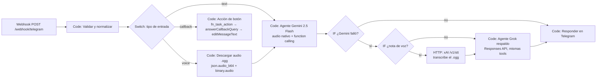
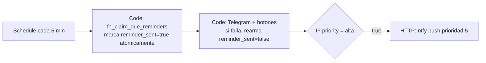
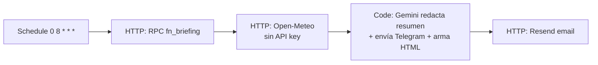
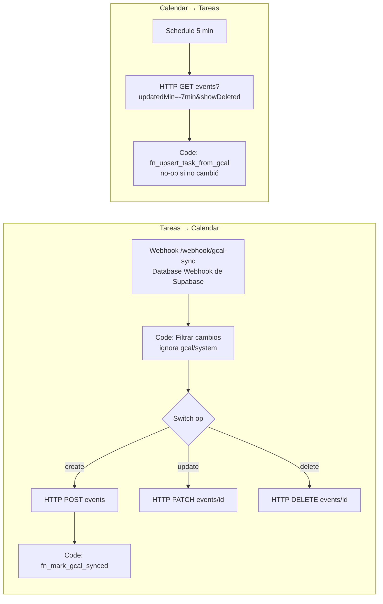

# Diseño de nodos n8n

Los 4 workflows se generan con `node scripts/build-n8n.mjs` a partir del código en `n8n/src/`,
las tools en `n8n/tools/agent-tools.json` y el prompt en `n8n/prompts/system-prompt.md`.
**No edites los JSON de `n8n/workflows/` a mano**: editá las fuentes y volvé a generarlos.

## Decisiones de arquitectura

| Decisión | Por qué |
|---|---|
| **Webhook propio** (no el nodo Telegram Trigger) + `secret_token` | Validamos la cabecera `X-Telegram-Bot-Api-Secret-Token` y el `chat_id`. Nadie más puede usar el bot. |
| **Gemini vía REST** desde un nodo Code (no el nodo AI Agent) | El AI Agent de n8n no acepta audio como entrada multimodal. Por REST mandamos el `.ogg` como `inlineData` → Gemini **escucha** el audio directamente, sin transcribir antes. |
| **La lógica de negocio vive en SQL** (`fn_*`) | n8n solo orquesta. Cada tool es una sola llamada RPC atómica, fácil de probar (`scripts/test-n8n-nodes.mjs`). |
| **Grok (xAI) de respaldo** | Si Gemini falla (caído, 429, 5xx, timeout o bloqueo) después de 1 reintento, el mismo pedido lo resuelve Grok con las mismas tools. Grok no escucha audio en el chat: la nota de voz se transcribe antes con `POST https://api.x.ai/v1/stt`. |
| **Las tareas abiertas van en el system prompt** | La coincidencia semántica ("ya hice lo del hormigón") la resuelve el LLM con los ids a la vista. `find_tasks` (pg_trgm) queda como respaldo. |
| **`fn_claim_due_reminders` con `FOR UPDATE SKIP LOCKED`** | Si dos ejecuciones del cron se pisan, ningún recordatorio sale dos veces. |
| **`last_modified_by`** | Corta el bucle Tareas → Calendar → Tareas. |

## WF1 · Telegram → Agente Gemini (+ respaldo Grok)



### Cómo escucha el audio Gemini 2.5 Flash
Telegram entrega las notas de voz como **OGG/Opus**. El nodo *Descargar audio* baja el archivo
(`getFile` → `/file/bot…/<path>`) y lo pasa a base64. El agente lo envía como una parte multimodal:

```json
{ "role": "user", "parts": [
  { "inlineData": { "mimeType": "audio/ogg", "data": "<base64>" } },
  { "text": "Nota de voz del usuario. Escuchala y ejecutá lo que pide." }
]}
```

Gemini entiende el audio directamente (tono, fechas dichas, varias instrucciones en un mismo audio) y en
la misma llamada decide qué tools ejecutar. No hay transcripción intermedia. Límite: ~20 MB por request
inline (una nota de voz de 1 minuto pesa ~100–300 KB).

### Respaldo con Grok
1. `geminiWithRetry`: si Gemini responde 429/5xx o timeout, reintenta 1 vez a los 1,5 s.
2. Si vuelve a fallar → `fallback: true` con las acciones que **ya** se ejecutaron (`actions_done`).
3. Si era audio → `POST https://api.x.ai/v1/stt` (multipart: `language=es`, `file` al final).
4. Grok recibe el mismo system prompt + tareas abiertas + la lista de acciones ya hechas (para no duplicar)
   y trabaja con las mismas tools vía `POST https://api.x.ai/v1/responses`.
5. La respuesta muestra lo que entendió del audio y la marca *⚡ Respondió Grok*.

El briefing matutino usa el mismo respaldo (`llmText`): si Gemini falla, Grok redacta el resumen.

**Probar el respaldo a propósito:** un mensaje que empieza con `/grok …` lo responde Grok aunque Gemini
funcione. Con la variable `FORZAR_GROK=true` en n8n, todo (también los audios) pasa por Grok.

## WF5 · Diagnóstico

`Probar ahora` (manual) o `/diagnostico` en Telegram → `GCal · prueba` (usa tu credencial OAuth) →
`Probar conexiones`: verifica variables, zona horaria de n8n y de la base, Telegram (y conecta el
webhook del bot), Gemini, Grok (que `GROK_MODEL` exista en `/v1/models`), transcripción xAI, Supabase
(y el aviso de cambios hacia n8n), Resend (manda un email de prueba), ntfy (manda un push de prueba) y
Google Calendar. El informe ✔/⚠/✘ con el motivo llega por Telegram.

Bucle del agente (`n8n/src/telegram/agente.js`):

1. `fn_agent_context(chat_id)` → hora local, hasta 60 tareas abiertas e historial de las últimas 6 h.
2. `generateContent` con `systemInstruction`, `contents` (historial + audio/texto) y `functionDeclarations`.
3. Si la respuesta trae `functionCall`(s): se ejecuta cada una (en orden) → se agrega el turno del modelo **tal cual** (conserva las *thought signatures* de 2.5) + un turno `functionResponse` → se vuelve a 2.
4. Sin `functionCall` → texto final → Telegram.

Botones (`callback_data` ≤ 64 bytes): `t:done:<uuid>`, `t:snooze_1h:<uuid>`, `t:tomorrow:<uuid>`.

## WF2 · Recordatorios (cada 5 min)



## WF3 · Briefing matutino (08:00 America/Argentina/Buenos_Aires)



## WF4 · Google Calendar ⇄ Tareas



Los eventos creados por el sistema llevan `extendedProperties.private.taskId`; así un evento recién
creado nunca duplica su tarea aunque el polling lo vea antes de guardar el `gcal_event_id`.

## Tools del agente (Gemini Function Calling)

Definición completa: [`n8n/tools/agent-tools.json`](../n8n/tools/agent-tools.json) — las mismas 7 tools para Gemini y Grok.

| Tool | RPC en Supabase | Uso típico (voz) |
|---|---|---|
| `create_task` | `fn_create_task` | "Mañana a las 10 llamar al proveedor de hormigón, es urgente" |
| `list_tasks` | `fn_list_tasks` | "¿Qué tengo esta semana de la consultora?" |
| `find_tasks` | `fn_find_tasks` (pg_trgm + unaccent) | respaldo de coincidencia semántica |
| `complete_task` | `fn_complete_task` | "Ya mandé la cotización de Bariloche" |
| `update_task` | `fn_update_task` | "Subile la prioridad a lo de los planos" |
| `reschedule_task` | `fn_reschedule_task` (con `cascade`) | "Me atrasé una hora con la reunión, corré todo lo que sigue" |
| `cancel_task` | `fn_task_action('cancel')` | "Cancelá la demo del viernes" |

## Probar los nodos sin n8n

```bash
# PostgreSQL local con database/001_init.sql aplicado (+ stubs de roles de Supabase)
PGURL="postgresql://postgres@localhost:5432/postgres" node scripts/test-n8n-nodes.mjs
```

Ejecuta el código real de cada nodo Code contra la base, con Telegram, Gemini y Grok simulados (incluye caídas de Gemini).
