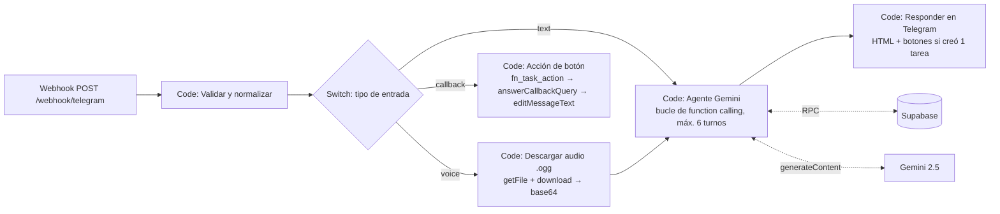
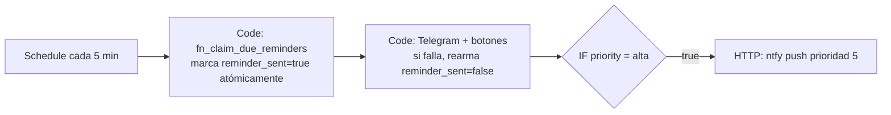
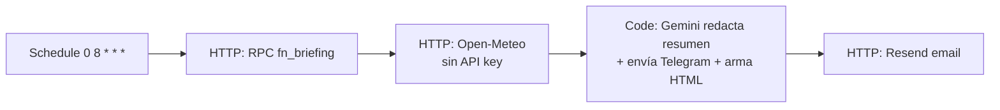
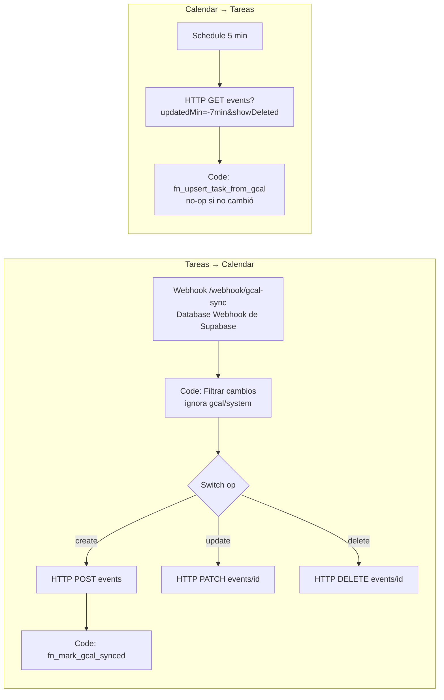

# Diseño de nodos n8n

Los 4 workflows se generan con `node scripts/build-n8n.mjs` a partir del código en `n8n/src/`,
las tools en `n8n/tools/gemini-tools.json` y el prompt en `n8n/prompts/system-prompt.md`.
**No edites los JSON de `n8n/workflows/` a mano**: editá las fuentes y volvé a generarlos.

## Decisiones de arquitectura

| Decisión | Por qué |
|---|---|
| **Webhook propio** (no el nodo Telegram Trigger) + `secret_token` | Validamos la cabecera `X-Telegram-Bot-Api-Secret-Token` y el `chat_id`. Nadie más puede usar el bot. |
| **Gemini vía REST** desde un nodo Code (no el nodo AI Agent) | El AI Agent de n8n no acepta audio como entrada multimodal. Por REST mandamos el `.ogg` como `inlineData` → Gemini **escucha** el audio directamente, sin transcribir antes. |
| **La lógica de negocio vive en SQL** (`fn_*`) | n8n solo orquesta. Cada tool es una sola llamada RPC atómica, fácil de probar (`scripts/test-n8n-nodes.mjs`). |
| **`web_search` es una tool que hace otra llamada a Gemini con `google_search`** | Gemini 2.5 no combina Google Search grounding con function calling en la misma request. Así el agente decide cuándo buscar. |
| **Las tareas abiertas van en el system prompt** | La coincidencia semántica ("ya hice lo del hormigón") la resuelve el LLM con los ids a la vista. `find_tasks` (pg_trgm) queda como respaldo. |
| **`fn_claim_due_reminders` con `FOR UPDATE SKIP LOCKED`** | Si dos ejecuciones del cron se pisan, ningún recordatorio sale dos veces. |
| **`last_modified_by`** | Corta el bucle Tareas → Calendar → Tareas. |

## WF1 · Telegram → Agente Gemini



Bucle del agente (`n8n/src/telegram/agente.js`):

1. `fn_agent_context(chat_id)` → hora local, hasta 60 tareas abiertas e historial de las últimas 6 h.
2. `generateContent` con `systemInstruction`, `contents` (historial + audio/texto) y `functionDeclarations`.
3. Si la respuesta trae `functionCall`(s): se ejecuta cada una (en orden) → se agrega el turno del modelo **tal cual** (conserva las *thought signatures* de 2.5) + un turno `functionResponse` → se vuelve a 2.
4. Sin `functionCall` → texto final → Telegram.

Botones (`callback_data` ≤ 64 bytes): `t:done:<uuid>`, `t:snooze_1h:<uuid>`, `t:tomorrow:<uuid>`.

## WF2 · Recordatorios (cada 5 min)



## WF3 · Briefing matutino (08:00 America/Argentina/San_Luis)



## WF4 · Google Calendar ⇄ Tareas



Los eventos creados por el sistema llevan `extendedProperties.private.taskId`; así un evento recién
creado nunca duplica su tarea aunque el polling lo vea antes de guardar el `gcal_event_id`.

## Tools del agente (Gemini Function Calling)

Definición completa: [`n8n/tools/gemini-tools.json`](../n8n/tools/gemini-tools.json).

| Tool | RPC en Supabase | Uso típico (voz) |
|---|---|---|
| `create_task` | `fn_create_task` | "Mañana a las 10 llamar al proveedor de hormigón, es urgente" |
| `list_tasks` | `fn_list_tasks` | "¿Qué tengo esta semana de la consultora?" |
| `find_tasks` | `fn_find_tasks` (pg_trgm + unaccent) | respaldo de coincidencia semántica |
| `complete_task` | `fn_complete_task` | "Ya mandé la cotización de Bariloche" |
| `update_task` | `fn_update_task` | "Subile la prioridad a lo de los planos" |
| `reschedule_task` | `fn_reschedule_task` (con `cascade`) | "Me atrasé una hora con la reunión, corré todo lo que sigue" |
| `cancel_task` | `fn_task_action('cancel')` | "Cancelá la demo del viernes" |
| `web_search` | Gemini + `google_search` | "Averiguá el precio del hormigón H21 en San Luis y anotalo en la tarea" |

## Probar los nodos sin n8n

```bash
# PostgreSQL local con database/001_init.sql aplicado (+ stubs de roles de Supabase)
PGURL="postgresql://postgres@localhost:5432/postgres" node scripts/test-n8n-nodes.mjs
```

Ejecuta el código real de cada nodo Code contra la base, con Telegram y Gemini simulados.
